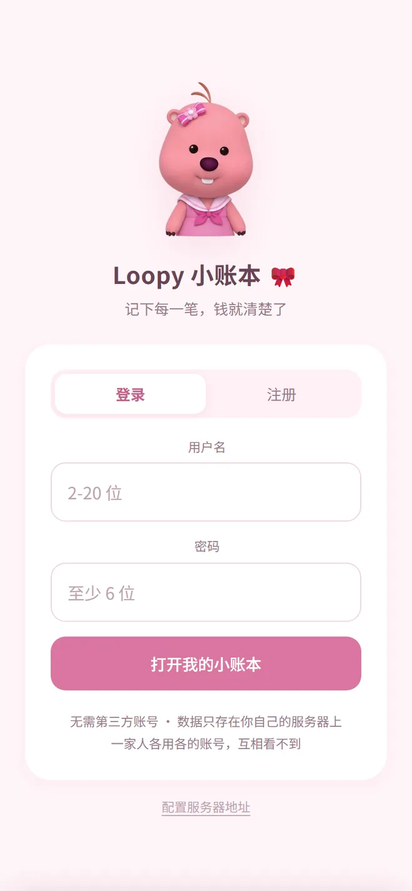
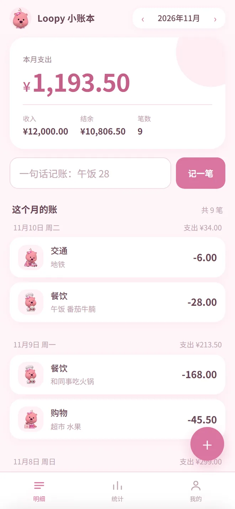
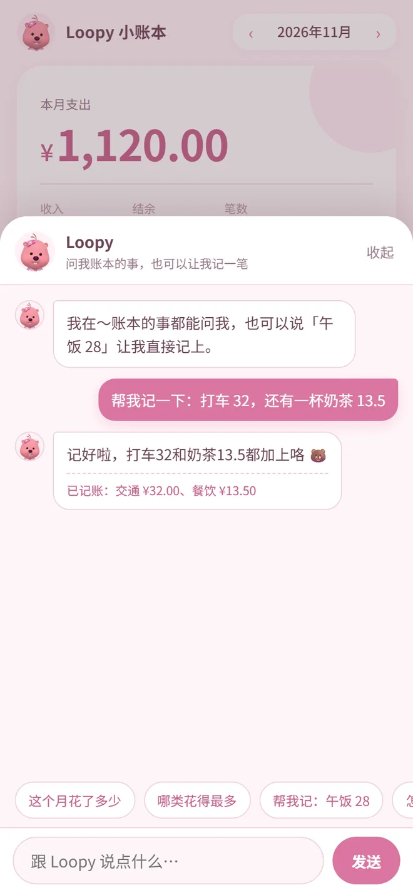
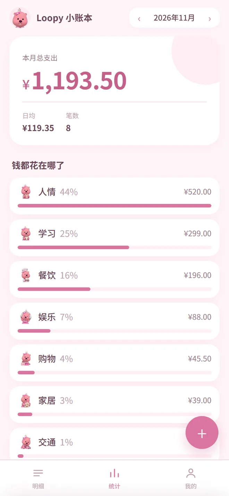
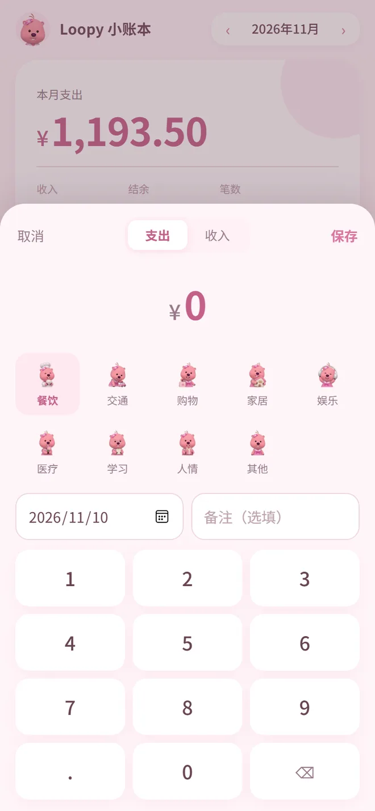

# Loopy 小账本

给家里人用的手机记账 App：**手机端 + 自己的服务器**，账目存在自己机器上，不经过任何第三方记账平台。

三端共用一套代码：安卓装 APK，iPhone 用 Safari「添加到主屏幕」，电脑浏览器直接打开。

<table>
  <tr>
    <td></td>
    <td></td>
    <td></td>
    <td></td>
    <td></td>
  </tr>
  <tr align="center">
    <td><sub>登录</sub></td>
    <td><sub>明细 + 一句话记账</sub></td>
    <td><sub>和 Loopy 聊天</sub></td>
    <td><sub>月度统计</sub></td>
    <td><sub>记账面板</sub></td>
  </tr>
</table>

界面沿用最初那版 Loopy 设计的配色与排版：背景 `#fff5f8`、正文 `#694454`、主色 `#d976a0`、描边 `#efd5e1`，
卡片 24px 圆角、输入框和按钮 14px 圆角。分类图标直接用了 Loopy 的九种小表情。

---

## 功能

| 功能 | 说明 |
|---|---|
| 一句话记账 | 输入「午饭 28，打车 15」自动拆成两笔，日期、分类、备注都填好 |
| 桌宠聊天 | 屏幕角落有只会眨眼、蹦跶的 Loopy，点她就能聊；顺口说「打车 32」也能直接记账 |
| AI 看账 | 统计页让 Loopy 读一遍当月数据，给两三条具体观察和一条建议 |
| 手动记账 | 自定义数字键盘，单手可操作，比系统输入法快 |
| 月度统计 | 支出构成、分类占比、近 6 个月趋势 |
| 多账号隔离 | 每人一个账号，各记各的，数据不串 |
| 导出备份 | 一键导出 JSON，换机或迁移时导入 |
| 离线查看 | 装了 PWA / APK 后断网也能打开看账目（记账需联网） |

## 下载安装

### 安卓

有两种用法，选一种就行。

**省事：直接用浏览器（推荐）**

1. 用 **Chrome** 打开 `https://ledger.krshare.site`
2. 登录后点右上角 `⋮` → **安装应用 / 添加到主屏幕**
3. 桌面多一个 Loopy 图标，点开是全屏的，没有地址栏

好处是**永远最新**：后端和界面都是线上的，不用重装。代价是没有推送通知（本来也没有）。

**装 APK**

**下载地址：<https://github.com/loopyjiang/xiaozhangben/releases/latest>**

点开 → 在 Assets 里下载 `xiaozhangben-1.3.2.apk` → 传到手机安装。装好打开就能直接登录，服务器地址已经填好了。

安装时系统会提示「未知来源应用」，允许一次即可。这是 debug 签名的包，能正常安装使用，只是不能上架应用商店。

> APK 里的前端是打包进去的，界面更新要重装新版本；只想看最新界面就别装 APK。
>
> 如果下载慢，把链接发到微信「文件传输助手」，手机上点开另存也行。

### iPhone

苹果**不允许安装未签名的 App**，所以 iPhone 走 PWA，体验几乎一样：

1. Safari 打开站点（例如 `https://ledger.krshare.site`）
2. 点底部「分享」按钮 → **添加到主屏幕**
3. 桌面出现图标，点开后全屏运行、没有地址栏

站点必须是 **HTTPS**，否则离线缓存不生效（浏览器的硬性要求）。

### 自己构建

**发版**：打个 tag 推上去，Actions 会自动构建并发布 Release（带 APK 附件）：

```bash
git tag -a v1.3.3 -m "v1.3.3 改了什么"
git push origin v1.3.3
```

**只想要构建产物**：推 `main` 分支也会打包，但只留在 Artifacts 里：

- 仓库 **Actions** → `构建手机安装包` → 最新一次运行 → 底部 **Artifacts** → `xiaozhangben-android-apk`
- 产物保留 90 天，过期就重新跑一次

iOS 的未签名 `.ipa` 需要手动触发（Actions → Run workflow），构建出来**装不进手机**，只有配上 Apple 开发者账号的签名证书后才有意义。

本地构建（需要 JDK 21 + Android SDK）：

```bash
npm install
python tools/gen_icons.py
npx cap add android && npx cap sync android
cd android && ./gradlew assembleDebug
# 产物：android/app/build/outputs/apk/debug/app-debug.apk
```

---

## 开始使用

**1. 首次打开会要求填服务器地址**

装成 App 后没有「当前网页」的概念，所以要手工指定后端：

```
https://ledger.krshare.site
```

填写时会先请求 `/api/health` 探活，通不过会直接提示，不会让你在错地址上白试。

**2. 注册账号**

需要管理员提供的**注册码**（服务器 `.env` 里的 `REGISTER_CODE`）。注册码只用于挡住陌生人注册，注册完之后登录不再需要。

服务器上查注册码：

```bash
sudo grep REGISTER_CODE /opt/ledger-app/.env
```

**3. 记账**

- 首页顶部输入「午饭 28」→ 记一笔
- 右下角粉色 `+` → 手动记账面板

---

## 部署到自己的服务器

### 前提

- 一台 Linux 服务器（Ubuntu 20.04+ / Debian 11+，1 核 1G 就够）
- Node.js 18+（脚本会自动装）
- 想用域名 + HTTPS 的话：域名已 **ICP 备案**，且备案接入商与服务器所在云厂商一致

> 备案只跟「域名 + 大陆服务器」有关，跟几个人用、公不公开无关。子域名不用单独备案，沿用主域名的备案号。

### 一键部署

```bash
curl -fsSL https://raw.githubusercontent.com/loopyjiang/xiaozhangben/main/deploy/install.sh -o /tmp/install.sh
sudo bash /tmp/install.sh
```

脚本会依次完成：拉代码 → 装 Node → 建运行账号 → 装依赖 → 生成 `.env` → 注册 systemd 服务 → 配 nginx → 申请证书。**可重复执行**，中途失败修完再跑一遍就行。

几个安全设计：

- 只新增自己的 nginx 配置（`ledger.conf`），不碰机器上已有的站点
- `nginx -t` 校验失败会自动撤销本次写入
- 服务只监听 `127.0.0.1:8080`，由 nginx 反代对外，端口不裸奔
- `.env` 已存在时不会被覆盖

国内机房直连 GitHub 经常被中断（`GnuTLS recv error -110`），脚本会自动依次尝试 ghproxy / gh-proxy / ghfast 镜像，最后兜底下载 `main.tar.gz` 解压。

### 手动部署

```bash
git clone https://github.com/loopyjiang/xiaozhangben.git /opt/ledger-app
cd /opt/ledger-app
npm install --omit=dev
cp .env.example .env && vi .env          # 改 REGISTER_CODE，填 ICP_BEIAN
mkdir -p /var/lib/ledger
useradd -r -s /usr/sbin/nologin ledger
chown -R ledger:ledger /var/lib/ledger /opt/ledger-app

cp deploy/ledger.service /etc/systemd/system/
systemctl daemon-reload && systemctl enable --now ledger
```

nginx 反代 + 证书：

```bash
cp deploy/nginx-ledger.conf.example /etc/nginx/conf.d/ledger.conf
# 改里面的 server_name 为你的域名
nginx -t && systemctl reload nginx
```

证书推荐直接用仓库里的脚本（走 certbot webroot，**不依赖 `python3-certbot-nginx` 插件**，很多机器上没装）：

```bash
sudo bash deploy/enable-https.sh
```

它会签证书、写 443 配置、把 80 跳转到 https，同时保留 ACME 验证路径供自动续期。可重复执行。

云服务器记得在**安全组**放行 80 和 443。8080 不用对外开放。

### 环境变量

| 变量 | 默认值 | 说明 |
|---|---|---|
| `PORT` | `8080` | 服务端口 |
| `HOST` | `127.0.0.1` | 监听地址。改 `0.0.0.0` 才会直接对外 |
| `REGISTER_CODE` | 空 | 注册邀请码。**强烈建议设置**，否则知道地址的人都能注册 |
| `DATA_DIR` | `./data` | 数据目录，建议放 `/var/lib/ledger` |
| `ICP_BEIAN` | 空 | 备案号，填了才会在页面底部展示并链接工信部 |
| `QWEN_API_KEY` | 空 | 通义千问 Key，填了才启用 AI 记账 |
| `AI_MODEL` | `qwen3.8-max` | 模型名 |
| `AI_THINKING` | `off` | 推理模型思考开关，见下节 |

完整列表见 [`.env.example`](.env.example)。

---

## AI 一句话记账

默认接**通义千问 `qwen3.8-max`**（阿里云百炼，国内直连，不需要代理）。

```bash
# /opt/ledger-app/.env
QWEN_API_KEY=sk-xxxx
AI_MODEL=qwen3.8-max
```

改完重启：`sudo systemctl restart ledger`。首页出现「一句话记账」输入框就说明生效了；没配 Key 时输入框自动隐藏，不影响其他功能。

**关于思考开关**：`qwen3.8-max` 是推理模型，默认会先思考再作答。记账是结构化抽取，不需要推理，所以默认关掉（`AI_THINKING=off`），实测单次从 5.2 秒降到 1.2 秒，思考 token 也不计费。想让它「想清楚点」可以设成 `on`。

**换别的服务商**（任何 OpenAI 兼容接口都行，豆包 / DeepSeek / 智谱……）：

```bash
AI_API_KEY=your-key
AI_BASE_URL=https://api.deepseek.com
AI_MODEL=deepseek-chat
```

`AI_API_KEY` 优先级最高；旧的 `DEEPSEEK_API_KEY` 写法也继续兼容。

### 用户自带接口

服务器配的 Key 是**所有人共用的默认值**。每个账号可以在「我的 → AI 记账 → 用自己的接口」里换成自己的地址、模型和 Key，改完立刻生效，也可以一键改回默认。

几个实现细节：

- 用户 Key 用 AES-256-GCM 加密后存进 `db.json`，主密钥在数据目录的 `.aisecret`（`0600`）。`db.json` 单独泄露也解不开；`.aisecret` 丢了只是要重填，账目不受影响。
- 前端只拿得到尾号掩码，接口 `GET /api/ai/config` 永远不返回完整 Key。
- 保存前有「测一下」，会真发一次请求，把 401 / 404 / 模型名不对这类错误翻成中文。
- 导出备份不含任何 Key，只导出账目。

服务器端的 Key 仍然只存在 `.env`（已进 `.gitignore`），不会打包进前端，也不会进 git。

### 和 Loopy 聊天（桌宠）

角落里那只 Loopy 是活的：会自己眨眼、悬空浮着、偶尔蹦一下。点她一下（或者「我的 → 找 Loopy 聊聊」）打开聊天面板，可以问账本的事，也可以直接说「打车 32，奶茶 13.5」让她记上。

几个边界都收好了：

- 回答只依据**当月统计 + 最近 12 笔**，账本里没有的会直说「账本里没有」，不会编数字。
- 一句话里有多笔会一起记，记完立刻出现在明细里，并回一句确认。
- 上下文最多带最近 10 轮；单账号每小时最多 60 条，防止误触把额度刷光。
- 桌宠可以按住拖到别处，位置记在手机本地；翻页滚动时她会自动半透明，不挡数字。
- 不想看到就在「我的 → 桌面宠物」关掉，聊天入口还留在 AI 卡片里。
- 聊天里不会提接口、模型、Key 这类技术细节。

接口是 `POST /api/ai/chat`，入参 `{ month, today, messages }`，返回 `{ reply, records }`；
`records` 非空时后端已经落库，前端直接插进列表。

---

## 日常维护

**更新代码**（不改 nginx、不碰证书、不改 `.env` 和数据，最安全）：

```bash
curl -fsSL https://raw.githubusercontent.com/loopyjiang/xiaozhangben/main/deploy/update.sh -o /tmp/u.sh \
  && sudo bash /tmp/u.sh
```

脚本会依次尝试 git → GitHub 直连 → 三个镜像。国内机房通常连不上 `github.com`，直连只等 15 秒就会切镜像，别以为是卡死了。更新完成后会打印健康检查，并逐项确认 `public/` 下的 Loopy 素材、图标和 Service Worker 版本都在。

如果网络全断，可以在能上网的电脑上生成快照，传上去再更新：

```bash
# 本地（仓库目录内）
git archive --format=tar.gz -o ledger-main.tgz HEAD
scp ledger-main.tgz 服务器:/tmp/ledger-main.tgz

# 服务器上
sudo env LOCAL_TARBALL=/tmp/ledger-main.tgz bash /tmp/u.sh
```

注意 `sudo` 会清空环境变量，`LOCAL_TARBALL` 必须写在 `sudo` 之后。快照里不含 `.env` 和 `data/`，覆盖不会丢配置或账目。

> 线上服务器是**纯文件部署**（没有 `.git`），别用 `git status` 判断版本，看 `/sw.js` 里的 `ledger-shell-vN` 缓存号，或者 `/api/health`。

**看状态和日志**：

```bash
systemctl status ledger
journalctl -u ledger -n 50
curl -s https://你的域名/api/health
```

`/api/health` 会告诉你当前状态，比如：

```json
{"ok":true,"aiEnabled":true,"ai":{"model":"qwen3.8-max","thinking":false},"users":2,"records":31,"icp":"京ICP备xxxxxxxx号-1"}
```

**备份**：App 里「我的」页有导出备份；服务器上直接备份数据文件更彻底：

```bash
sudo cp /var/lib/ledger/db.json ~/ledger-$(date +%F).json
```

**证书续期**：certbot 装好后会自动续，不用管。想确认：`systemctl list-timers | grep certbot`。

### 几个要注意的坑

1. **服务器是唯一单点**。停机、欠费、到期，App 就打不开。务必开自动续费。
2. **安卓端的前端是打包进 APK 的**。改了界面要**重新装 APK** 才能看到；iPhone 和浏览器刷新页面就行。后端（AI、接口）改动则三端都立即生效。
3. **iPhone 长期不打开，系统可能清掉本地缓存**，重开会变成未登录。数据全在服务器上，重新登录就回来了。
4. **`deploy/install.sh` 会重写 nginx 的 80 段配置**（检测到已有 443 时跳过）。日常升级请用 `update.sh`。

---

## 项目结构

```
ledger-app/
├── server/                后端
│   ├── index.js           Express 路由：鉴权、账目、AI、导入导出
│   ├── auth.js            scrypt 密码哈希 + token 会话
│   ├── store.js           JSON 存储，原子写入 + 防抖落盘
│   ├── ai.js              AI 解析、月度分析、桌宠聊天，供应商无关（通义 / DeepSeek / 任意兼容接口）
│   ├── secret.js          用户自带 Key 的 AES-256-GCM 加解密
│   └── env.js             轻量 .env 解析
├── public/                前端（无框架，纯原生 JS）
│   ├── index.html
│   ├── app.css
│   ├── app.js
│   ├── manifest.webmanifest
│   ├── sw.js              Service Worker 离线缓存
│   ├── icons/             PWA / 主屏图标
│   └── loopy/             九种 Loopy 表情 + 眨眼/开心两帧（分类图标、桌宠、头像、登录页主图）
├── deploy/
│   ├── install.sh         一键部署
│   ├── update.sh          只更新代码
│   ├── enable-https.sh    单独修 HTTPS（certbot webroot）
│   ├── ledger.service     systemd 单元
│   └── nginx-ledger.conf.example
├── tools/
│   ├── gen_icons.py       粉底 + Loopy 头生成全套图标，素材缺失时退回 ¥ 图标
│   ├── split_loopy.py     把 3×3 精灵图拆成单帧 / 头像 / 高清主图
│   ├── gen_pet.py         给桌宠画眨眼和开心两帧（补眼 + 贝塞尔笑眼）
│   └── shot.mjs           CDP 手机视口截图，用于自查界面
└── .github/workflows/
    └── build.yml          云端构建安卓 APK / iOS 未签名包
```

## 技术栈

- **后端**：Node.js 18+ / Express 4，数据用 JSON 文件 + 原子写入（2G 小内存机器上不装数据库，避免原生模块编译问题）
- **前端**：原生 HTML/CSS/JS，零框架零构建，首屏约 100 KB
- **PWA**：manifest + Service Worker，可加到主屏幕、可离线查看
- **原生壳**：Capacitor 6，页面打包进 APK，从本地加载
- **CI**：GitHub Actions，JDK 21 + Gradle 出 debug 包

选型的核心约束是**服务器只有 2 Mbps 带宽**：不引框架、不引 UI 库，所有资源加起来也就一百多 KB。

## 已知限制

- APK 是 **debug 签名**，能装能用，不能上架应用商店（也不需要）
- iOS 未签名 `.ipa` **装不进手机**，需要 Apple 开发者账号（¥688/年）才能签名；不折腾就用 PWA
- 记账必须联网（要落库），离线只能查看
- 没有多设备实时同步推送，切换设备时刷新即可

## License

私人自用项目，未做对外开源授权。想拿去改成自己的记账应用，自行 fork 即可。

`public/loopy/` 和 `assets/loopy-head.webp` 里的 Loopy 形象版权归原作者所有，这里只当自用界面素材，
不构成任何形式的授权或再分发。要对外发布请换掉这些图，其余代码不受影响。
